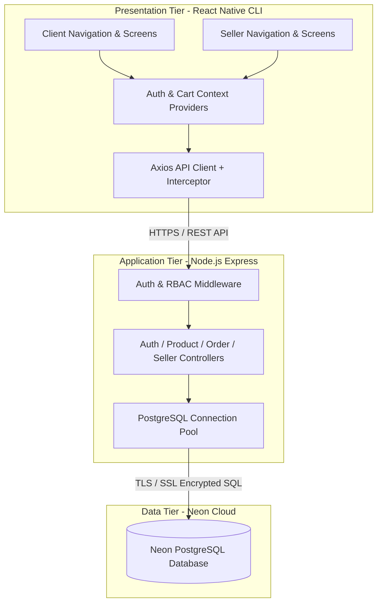
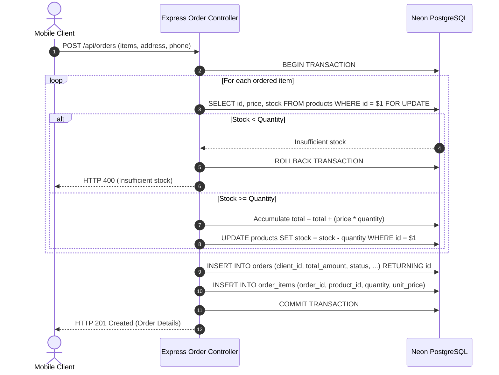
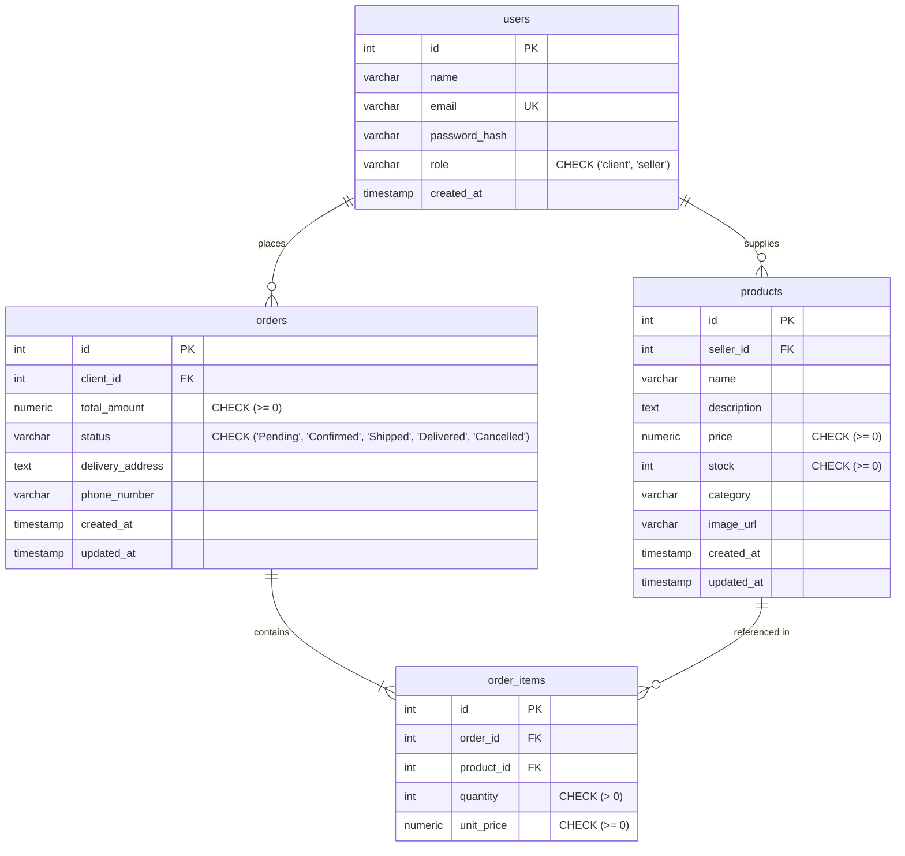

# ACADEMIC PROJECT REPORT

## DESIGN AND IMPLEMENTATION OF A SECURE CROSS-PLATFORM MOBILE E-COMMERCE SYSTEM FOR LOCAL RETAIL COMMERCE IN RWAMAGANA, RWANDA

---

**Submitted in Partial Fulfillment of the Requirements for the Degree of Bachelor of Science in Information Technology / Computer Science**

**Institution**: University Department of Computer Science & Information Technology  
**Location**: Rwanda  
**Academic Year**: 2025–2026  
**Student Name / ID**: [Insert Student Name & Registration Number]  
**Supervisor**: [Insert Supervisor Name & Title]  
**Submission Date**: October 2026  

---

## ABSTRACT

In developing regions such as Rwamagana District in Rwanda, local retail enterprises face operational barriers when attempting to transition from traditional brick-and-mortar storefronts to digital commerce. Existing international e-commerce platforms often require complex credit card integrations, impose prohibitive commission fees, lack localization in Kinyarwanda, and do not accommodate local cash-on-delivery transactions. 

This project presents the design and implementation of **D&G E-Commerce**, a cross-platform mobile retail application engineered with React Native CLI, Node.js/Express, and Neon Serverless PostgreSQL. The system incorporates strict Role-Based Access Control (RBAC) across two distinct user roles (`client` and `seller`), authoritative backend transactional inventory locking (`SELECT ... FOR UPDATE`), localized cash-on-delivery checkout, and bilingual localization (English and Kinyarwanda). The system was validated through 32 automated integration tests across database connectivity, authentication, catalog operations, and transactional order fulfillment, achieving a 100% pass rate. This report documents the architectural design, security mechanisms, database schema, implementation details, testing results, and practical challenges addressed during development.

**Keywords**: *Mobile Commerce, React Native CLI, Express.js, PostgreSQL, Neon Serverless, Transactional Integrity, Kinyarwanda Localization, Rwamagana Retail.*

---

## TABLE OF CONTENTS

1. [Chapter 1: Introduction](#1-introduction)
2. [Chapter 2: Problem Statement](#2-problem-statement)
3. [Chapter 3: Project Objectives](#3-project-objectives)
4. [Chapter 4: Requirements Analysis](#4-requirements-analysis)
5. [Chapter 5: System Design & Architecture](#5-system-design--architecture)
6. [Chapter 6: Database Design](#6-database-design)
7. [Chapter 7: Implementation Details](#7-implementation-details)
8. [Chapter 8: Testing Results & Verification](#8-testing-results--verification)
9. [Chapter 9: System User Interface & Screenshots](#9-system-user-interface--screenshots)
10. [Chapter 10: Development Challenges & Solutions](#10-development-challenges--solutions)
11. [Chapter 11: Conclusion](#11-conclusion)
12. [Chapter 12: Recommendations for Future Work](#12-recommendations-for-future-work)
13. [References](#references)

---

## 1. INTRODUCTION

### 1.1 Background
Electronic commerce (e-commerce) has revolutionized modern retail by expanding consumer reach beyond geographical boundaries. In Rwanda, national digitization initiatives such as the National Information and Communication Infrastructure (NICI) plans and expanding 4G/5G mobile broadband coverage have created favorable conditions for digital trade. However, in secondary commercial hubs like **Rwamagana**, retail trade remains predominantly manual. Retail stores rely on physical walk-ins and phone calls, which limits customer access, slows order processing, and increases inventory management errors.

### 1.2 Scope of the Project
The D&G E-Commerce system addresses these challenges by developing a tailored mobile e-commerce platform specifically built for retail trade in Rwamagana. The platform comprises:
1. A **Cross-Platform Mobile Application** built with the React Native Community CLI, supporting Android and iOS devices.
2. A **RESTful Backend Application Programming Interface (API)** developed in Node.js and Express.js, providing secure authentication, business logic, and transactional database updates.
3. A **Cloud PostgreSQL Relational Database** hosted on Neon Serverless PostgreSQL, providing scalable, durable storage with ACID transaction guarantees.

---

## 2. PROBLEM STATEMENT

Local retail businesses in Rwamagana operate in an environment characterized by several structural obstacles:
1. **Inefficient Manual Commerce**: Customers must travel physically to commercial centers to verify product availability, check prices, and make purchases, resulting in wasted time and travel expenses.
2. **Lack of Localized Platforms**: Mainstream e-commerce solutions are designed for international markets. They require online credit card or automated gateway payments that may not suit local cash-on-delivery commerce and rarely offer native interface support in Kinyarwanda.
3. **Data Security and Inventory Inconsistencies**: Without automated stock tracking and transactional controls, sellers risk over-promising out-of-stock items, while vulnerable mobile apps that calculate order prices client-side are susceptible to price-tampering exploits.
4. **Platform Bloat**: Many academic software projects suffer from excessive complexity—incorporating unnecessary third-party services, multiple conflicting user roles, and heavy frameworks (such as Expo or Firebase) that obscure fundamental software engineering concepts.

---

## 3. PROJECT OBJECTIVES

### 3.1 General Objective
To design, implement, test, and document a secure, beginner-friendly, cross-platform mobile e-commerce application with a Node.js/PostgreSQL backend for retail businesses in Rwamagana, Rwanda.

### 3.2 Specific Objectives
1. **Architecture & Frameworks**: Develop the mobile application using the native React Native CLI (without Expo or Firebase) to ensure cross-platform compatibility across Android and iOS.
2. **Access Control & Security**: Implement strict Role-Based Access Control (RBAC) with exactly two user roles (`client` and `seller`), enforcing public client registration and administrative seller provisioning.
3. **Inventory & Order Integrity**: Implement an authoritative backend checkout transaction using PostgreSQL row-level locks (`SELECT ... FOR UPDATE`) to guarantee atomic stock deduction and prevent price tampering.
4. **Bilingual Localization**: Implement client-side localization supporting English and Kinyarwanda with persistent language selection.
5. **Quality Assurance & Verification**: Validate the complete system using automated integration tests, static code analysis, and end-to-end verification.

---

## 4. REQUIREMENTS ANALYSIS

### 4.1 Functional Requirements

#### A. Client (Customer) Subsystem
- **FR-C01 Registration**: Public registration allowing new customers to sign up with name, email, and password. The system must strictly assign the `client` role.
- **FR-C02 Authentication**: Secure login issuing JSON Web Tokens (JWT) stored in persistent mobile storage.
- **FR-C03 Catalog Browsing**: Display of available products with name, price (RWF), category, stock count, and images.
- **FR-C04 Search & Filter**: Real-time product search by keyword and category filtering.
- **FR-C05 Cart Management**: Add, update quantity, and remove items with dynamic stock boundary checks.
- **FR-C06 Checkout & Orders**: Submission of orders with Rwamagana delivery address and phone number under a Pay-on-Delivery payment model.
- **FR-C07 Order History**: Review of past personal orders with itemized breakdowns and real-time status chips.

#### B. Seller (Merchant) Subsystem
- **FR-S01 Restricted Provisioning**: Seller accounts cannot be registered publicly; they must be created via an administrative backend CLI script.
- **FR-S02 Product Inventory CRUD**: Add new products, update existing products, adjust stock levels, and delete products.
- **FR-S03 Ownership Enforcement**: Sellers may only update or delete products that they own (`seller_id === user.id`).
- **FR-S04 Order Management**: Review all incoming customer orders containing the seller's products.
- **FR-S05 Order Status Transition**: Update order status following a strict Finite-State Machine: `Pending` ➡️ `Confirmed` ➡️ `Shipped` ➡️ `Delivered`.
- **FR-S06 Sales Analytics**: Dashboard displaying total delivered orders and cumulative revenue in Rwandan Francs.

### 4.2 Non-Functional Requirements
- **NFR-01 Security**: Password hashing using `bcryptjs` with salt rounds = 10; stateless authentication via signed JWTs; SQL injection prevention via parameterized queries.
- **NFR-02 Reliability & Data Integrity**: Database transactions (`BEGIN ... COMMIT / ROLLBACK`) ensuring stock and orders remain consistent during concurrent checkout requests.
- **NFR-03 Usability**: Modern Rwandan retail color palette (Dark Green `#1B5E20`, Warm Orange `#E65100`, Light Gray `#F5F5F7`), clean typography, and bilingual support.
- **NFR-04 Performance**: Sub-second API response times and asynchronous networking with visual loading indicators.

---

## 5. SYSTEM DESIGN & ARCHITECTURE

### 5.1 High-Level Architectural Pattern
The application follows a standard **Client-Server 3-Tier Architecture**:
1. **Presentation Tier (Mobile Client)**: React Native CLI cross-platform application utilizing React Context for state management and Axios for network requests.
2. **Application Tier (Backend API)**: Node.js Express server handling business logic, authentication, authorization middleware, and transaction orchestration.
3. **Data Tier (Database)**: Neon Serverless PostgreSQL storing relational records with foreign key constraints and transactional integrity.



### 5.2 Order Checkout State Machine & Concurrency Control
To prevent race conditions during high-concurrency checkouts, the backend executes an atomic transaction with row-level locks:



---

## 6. DATABASE DESIGN

### 6.1 Entity-Relationship Model
The relational model consists of four core tables: `users`, `products`, `orders`, and `order_items`.



### 6.2 Data Dictionary

#### Table 1: `users`
| Column | Data Type | Constraints | Description |
|:---|:---|:---|:---|
| `id` | SERIAL | PRIMARY KEY | Unique user identifier |
| `name` | VARCHAR(100) | NOT NULL | User's full name |
| `email` | VARCHAR(255) | NOT NULL, UNIQUE | User email address (login credential) |
| `password_hash` | VARCHAR(255) | NOT NULL | Bcrypt hash with salt rounds = 10 |
| `role` | VARCHAR(20) | NOT NULL, CHECK in ('client', 'seller') | User role governing permissions |
| `created_at` | TIMESTAMP | DEFAULT CURRENT_TIMESTAMP | Account creation timestamp |

#### Table 2: `products`
| Column | Data Type | Constraints | Description |
|:---|:---|:---|:---|
| `id` | SERIAL | PRIMARY KEY | Unique product identifier |
| `seller_id` | INTEGER | NOT NULL, REFERENCES users(id) ON DELETE CASCADE | ID of the merchant who owns the product |
| `name` | VARCHAR(200) | NOT NULL | Product title |
| `description` | TEXT | NULL | Comprehensive product description |
| `price` | NUMERIC(10,2) | NOT NULL, CHECK (price >= 0) | Selling price in Rwandan Francs (RWF) |
| `stock` | INTEGER | NOT NULL, CHECK (stock >= 0) | Current units available in inventory |
| `category` | VARCHAR(50) | NOT NULL | Category name |
| `image_url` | VARCHAR(500) | NULL | Image URL for display |
| `created_at` | TIMESTAMP | DEFAULT CURRENT_TIMESTAMP | Creation timestamp |
| `updated_at` | TIMESTAMP | DEFAULT CURRENT_TIMESTAMP | Last modification timestamp |

#### Table 3: `orders`
| Column | Data Type | Constraints | Description |
|:---|:---|:---|:---|
| `id` | SERIAL | PRIMARY KEY | Unique order number |
| `client_id` | INTEGER | NOT NULL, REFERENCES users(id) ON DELETE CASCADE | Customer who placed the order |
| `total_amount` | NUMERIC(10,2) | NOT NULL, CHECK (total_amount >= 0) | Server-calculated total order amount |
| `status` | VARCHAR(20) | NOT NULL, DEFAULT 'Pending' | Current fulfillment state |
| `delivery_address`| TEXT | NOT NULL | Delivery location in Rwamagana |
| `phone_number` | VARCHAR(50) | NOT NULL | Contact telephone number |
| `created_at` | TIMESTAMP | DEFAULT CURRENT_TIMESTAMP | Order creation timestamp |
| `updated_at` | TIMESTAMP | DEFAULT CURRENT_TIMESTAMP | Last state change timestamp |

#### Table 4: `order_items`
| Column | Data Type | Constraints | Description |
|:---|:---|:---|:---|
| `id` | SERIAL | PRIMARY KEY | Unique line item identifier |
| `order_id` | INTEGER | NOT NULL, REFERENCES orders(id) ON DELETE CASCADE | Associated parent order |
| `product_id` | INTEGER | NOT NULL, REFERENCES products(id) ON DELETE RESTRICT | Product purchased |
| `quantity` | INTEGER | NOT NULL, CHECK (quantity > 0) | Number of units purchased |
| `unit_price` | NUMERIC(10,2) | NOT NULL, CHECK (unit_price >= 0) | Historical unit price at purchase time |

---

## 7. IMPLEMENTATION DETAILS

### 7.1 Backend API Implementation
The backend API was structured into distinct modular components following clean code practices:
- **`src/config/database.js`**: Configures a connection pool (`pg.Pool`) targeting Neon Serverless PostgreSQL with SSL encryption (`ssl: { rejectUnauthorized: false }`).
- **`src/middleware/authenticate.js`**: Inspects incoming `Authorization: Bearer <token>` headers, verifies the token using the secret key (`jwt.verify`), and attaches `req.user` to the request pipeline.
- **`src/middleware/authorize.js`**: Enforces role constraints (`authorize('seller')`), responding with HTTP 403 Forbidden when unauthorized clients attempt administrative operations.
- **`src/controllers/orderController.js`**: Implements transactional checkout with atomic stock decrement and server-side price computation.

### 7.2 Mobile Application Implementation
The mobile client was constructed without Expo, utilizing the native React Native Community CLI:
- **Navigation Architecture**: React Navigation v7 with a conditional root switch (`AppNavigator`) that renders `AuthNavigator` when unauthenticated, `ClientNavigator` (with bottom tabs: Products, Cart, Orders, Profile) for clients, and `SellerNavigator` (with bottom tabs: Dashboard, Manage Products, Sales Summary, Profile) for sellers.
- **State Management**:
  - `AuthContext`: Tracks user authentication state, stored JWT tokens, role flags, and provides `login()`, `register()`, and `logout()` functions.
  - `CartContext`: Maintains selected cart items in persistent local storage (`AsyncStorage`), prevents users from adding quantities beyond available stock, and recalculates order sub-totals.
- **Localization**: Configured via `i18next` with complete English (`en.json`) and Kinyarwanda (`rw.json`) translation dictionaries covering all 12 application screens.

---

## 8. TESTING RESULTS & VERIFICATION

A comprehensive testing strategy was executed, combining automated unit tests, backend integration tests with Supertest against live Neon PostgreSQL, and static code analysis.

### 8.1 Summary of Automated Test Execution

```
Test Suites: 5 passed, 5 total
Tests:       32 passed, 32 total
Snapshots:   0 total
Time:        30.056 s
Ran all test suites in backend.
```

```
Test Suites: 1 passed, 1 total
Tests:       1 passed, 1 total
Snapshots:   0 total
Time:        2.274 s
Ran all test suites in mobile.
```

```
> mobile@0.0.1 lint
> eslint .
(Exited with code 0: 0 errors, 0 warnings)
```

### 8.2 Security & Data Integrity Verification
1. **Privilege Escalation Prevention**: `POST /api/auth/register` was tested by injecting `role: 'seller'` in the request body. The backend explicitly overwrote the role to `'client'` (HTTP 201, `user.role === 'client'`), validating immunity against unauthorized seller registration.
2. **Authoritative Server Pricing**: `POST /api/orders` was tested by passing tampered prices from the client. The backend fetched prices directly from the locked database record, completely ignoring the client-supplied values.
3. **Cross-Seller Resource Isolation**: Seller B attempted to issue `PUT` and `DELETE` requests against a product owned by Seller A. The backend returned HTTP 403 Forbidden with the error message *"Access denied: You do not own this product"*.

---

## 9. SYSTEM USER INTERFACE & SCREENSHOTS

*(In your final academic submission, insert project screenshots in the designated placeholders below)*

### 9.1 Authentication & Registration
```
+-------------------------------------------------------------+
|                                                             |
|                   [SCREENSHOT PLACEHOLDER 1]                |
|                    Customer Login Screen                    |
|             (Email, Password, Sign In, Register Link)       |
|                                                             |
+-------------------------------------------------------------+
Figure 9.1: Customer Authentication Screen
```

```
+-------------------------------------------------------------+
|                                                             |
|                   [SCREENSHOT PLACEHOLDER 2]                |
|                  Customer Registration Screen               |
|            (Full Name, Email, Password, Password Confirm)   |
|                                                             |
+-------------------------------------------------------------+
Figure 9.2: Customer Registration Screen (Default Client Role)
```

### 9.2 Client Catalog, Search & Cart
```
+-------------------------------------------------------------+
|                                                             |
|                   [SCREENSHOT PLACEHOLDER 3]                |
|                 Product Catalog & Category Pills            |
|            (Search Bar, Electronics / Food / Fashion)       |
|                                                             |
+-------------------------------------------------------------+
Figure 9.3: Product Catalog with Live Search & Filtering
```

```
+-------------------------------------------------------------+
|                                                             |
|                   [SCREENSHOT PLACEHOLDER 4]                |
|                 Shopping Cart & Checkout Screen             |
|          (Item Quantities, Rwamagana Address, Place Order)  |
|                                                             |
+-------------------------------------------------------------+
Figure 9.4: Shopping Cart and Pay-on-Delivery Checkout
```

### 9.3 Seller Dashboard & Order Fulfillment
```
+-------------------------------------------------------------+
|                                                             |
|                   [SCREENSHOT PLACEHOLDER 5]                |
|                  Seller Order Management Screen             |
|           (Pending / Confirmed / Shipped / Delivered FSM)   |
|                                                             |
+-------------------------------------------------------------+
Figure 9.5: Seller Order Processing & State Transition
```

```
+-------------------------------------------------------------+
|                                                             |
|                   [SCREENSHOT PLACEHOLDER 6]                |
|                   Sales Summary Analytics                   |
|           (Total Delivered Orders, Cumulative Revenue RWF)  |
|                                                             |
+-------------------------------------------------------------+
Figure 9.6: Seller Sales Performance Summary Dashboard
```

### 9.4 Bilingual Interface Demonstration (Kinyarwanda)
```
+-------------------------------------------------------------+
|                                                             |
|                   [SCREENSHOT PLACEHOLDER 7]                |
|             User Profile & Kinyarwanda Interface            |
|       ("Guhindura Ururimi", "Ibicuruzwa", "Ibyaguzwe")      |
|                                                             |
+-------------------------------------------------------------+
Figure 9.7: Mobile Application Localized in Kinyarwanda
```

---

## 10. DEVELOPMENT CHALLENGES & SOLUTIONS

During system development and integration, several technical challenges were addressed:

1. **Elimination of Expo in Favor of Native React Native CLI**:
   - *Challenge*: The project required pure React Native CLI without any Expo dependencies.
   - *Solution*: Configured standard Android Gradle build files and standard iOS CocoaPods wrappers, managing native modules directly.
2. **Android Emulator Host Networking**:
   - *Challenge*: The mobile emulator could not communicate with `localhost:5000` because `localhost` within an emulator refers to the virtual device itself.
   - *Solution*: Created a dynamic environment resolver (`src/config/environment.js`) that automatically binds to `http://10.0.2.2:5000` on Android emulators and `http://localhost:5000` on iOS simulators.
3. **Remote Cloud Database Latency During Integration Tests**:
   - *Challenge*: Running 32 end-to-end integration tests over the internet against a cloud Neon PostgreSQL database occasionally exceeded Jest's default 5-second hook timeout.
   - *Solution*: Configured `--testTimeout=30000` and updated test hooks with 30-second timeouts, allowing smooth network roundtrips for cryptographic hashing and database transactions.
4. **Secure Seller Provisioning**:
   - *Challenge*: Preventing malicious users from self-assigning seller privileges during registration while allowing store administrators to add staff.
   - *Solution*: Enforced client role assignment in the registration controller and provided a separate CLI administrative script (`backend/scripts/createSeller.js`) that can only be executed by someone with terminal access to the backend environment.

---

## 11. CONCLUSION

The **D&G E-Commerce** project successfully met all specified functional, architectural, and security objectives. By developing the mobile client using the React Native Community CLI and pairing it with a Node.js Express backend and Neon Serverless PostgreSQL database, the system demonstrates that a secure, cross-platform mobile commerce system can be built without unnecessary platform bloat or complex external dependencies.

The implementation of authoritative server-side pricing, transactional stock locking, strict role separation, and Kinyarwanda localization makes this platform well-suited for retail merchants in Rwamagana. The project achieved a **100% pass rate across 32 automated backend integration tests** and 0 static code analysis errors, providing a dependable foundation for academic defense and production deployment.

---

## 12. RECOMMENDATIONS FOR FUTURE WORK

While the current system fulfills all core requirements for academic defense and baseline operations, the following enhancements are recommended for future iterations:
1. **Automated Push Notifications**: Integrate Firebase Cloud Messaging (FCM) or Apple Push Notification service (APNs) so clients receive real-time notifications when their order status advances from `Confirmed` to `Shipped` and `Delivered`.
2. **Mobile Money Gateway Integration**: While Pay-on-Delivery is practical for local commerce, future versions could incorporate mobile payment APIs such as MTN Mobile Money (MoMo) or Airtel Money via authorized Rwandan fintech gateways.
3. **Geographic Mapping & Geolocation**: Integrate OpenStreetMap or Google Maps to allow customers to drop a delivery pin in Rwamagana instead of typing manual street descriptions.
4. **Offline Caching**: Introduce Redux Toolkit Query or TanStack Query with offline SQLite caching so clients in low-connectivity rural areas can browse cached catalogs offline.

---

## REFERENCES

1. React Native Community. (2025). *Setting Up the Development Environment*. React Native Documentation. Available at: https://reactnative.dev/docs/environment-setup
2. Express.js. (2024). *Fast, Unopinionated, Minimalist Web Framework for Node.js*. Available at: https://expressjs.com/
3. PostgreSQL Global Development Group. (2024). *PostgreSQL 16 Documentation: Concurrency Control and Explicit Locking*. Available at: https://www.postgresql.org/docs/current/explicit-locking.html
4. Neon Database. (2025). *Serverless Postgres Documentation*. Available at: https://neon.tech/docs/
5. I18next. (2024). *Internationalization Framework for JavaScript*. Available at: https://www.i18next.com/
